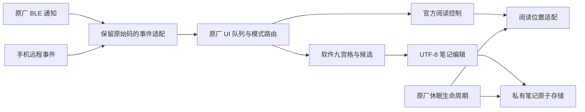

# 九宫格与笔记模块提案

【推断】本页是设计，尚未实现或实机验证。
契约见 firmware/solreader_custom/include/solreader/contracts.hpp，
只有 C++17 设备无关类型/抽象接口，未集成 ESP-IDF。

## 输入边界

InputAction 对应原厂已确认的 UP/LEFT/ENTER/RIGHT/DOWN/BACK；
InputEvent 增加 source、timestamp、可选 raw_code/gesture。
不把 ANIMATION 当实体按键，不从逻辑命令凭空重建 release/repeat，
不把五方向 PT 常量当作实体按键事实。
软件网格支持焦点移动与确认；9组字母/音节由屏幕导航选择，
不要求九个实体键。具体短按/长按/组合映射待真实协议核验，
读取模式保持现有翻页与菜单行为。

## 模块职责

- TextComposition：组合串、候选接受、取消；后续定义候选分页和有界词库，
  与显示/按键协议脱离。词库、频率数据和字体各自审核许可及资源上限。
- 编辑器：合法 UTF-8 游标边界、删除、撤回；组合未提交文本与已提交笔记分开。
  最初支持码点边界，组合字符等完整 grapheme 行为需明确测试，不能称已支持。
- NoteStore：独立 note_id、revision 与 UTF-8 原子保存，
  拒绝旧 revision，保留上次完整内容；采用临时文件→提交/恢复策略，
  实际文件系统原子性、断电恢复和磨损需验证。用户笔记不走公开 Git/遥测。
- ProgressStore：文档标识、内容指纹、TXT/EPUB spine 与字节位置、布局版本；
  使用规范化 UTF-8 内容的位置，不能把 GBK 原字节位置直接应用到转码文件。
  未来包装原厂 place/prefs，不破坏已有进度格式。
- ShutdownParticipant：原厂关闭 Dispatch/存储之前，
  有界等待保存、报告失败；低电量时处理日志不得包含私人文字。
- 模式路由：读写切换时先保存、取消/提交组合态、保留阅读位置；
  中文写作菜单不侵入原厂驱动和功耗状态机。

本轮不创建假字典、假按键驱动或能写设备的固件入口。
资源、候选质量、可用性与保存故障的测试矩阵见 tests/README.md。
